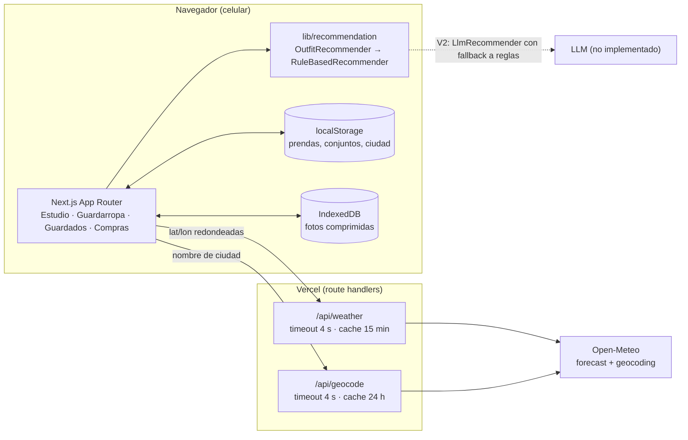

# Smart Closet AI · Prototipo V1

Asistente de estilo que te ayuda a decidir **qué ponerte hoy con la ropa que ya tenés**, según la ocasión y el clima del día.

Proyecto de MBA (Product, Technology & Operations 4.0, UCEMA). Es una primera versión: algunas cosas funcionan de verdad, otras están simuladas y otras aparecen como "Próximamente". Dentro de la app, cada función lleva una etiqueta con su estado y la página **Sobre este prototipo** (`/about`) tiene la lista completa.

**Usuario objetivo:** alguien que a la mañana, antes de salir, pierde tiempo eligiendo qué ponerse y termina usando siempre lo mismo.

## Estado de cada función

### ✅ Funciona
| Función | Detalle |
|---|---|
| Clima del día | Temperatura actual, mínima/máxima, probabilidad de lluvia y ciudad, vía Open-Meteo. Usa la temperatura de la mañana (7-11 h) y de la tarde (13-18 h), no solo la actual. |
| Ubicación | Geolocalización del navegador. Si la rechazás o falla, usa Buenos Aires y podés buscar otra ciudad. |
| Clima manual | Si Open-Meteo no responde, aparece "No pudimos traer el clima" y cargás temperatura y lluvia a mano. La recomendación sigue andando. |
| Armame un conjunto | Motor de reglas: arriba + abajo + calzado (o prenda entera + calzado), y abrigo si hace frío o llueve. |
| Por qué este conjunto | Motivos en lenguaje simple ("Sumamos blazer azul marino porque a las 9 h hacen 11 °C"). Si ningún conjunto cumple todas las reglas, muestra el mejor posible y aclara qué regla no se cumple. |
| Probá otra | Siguiente mejor opción, sin repetir y cambiando al menos dos prendas cuando se puede. |
| Guardarropa | Toggle "De muestra" (13 prendas) / "Mi ropa", filtros por categoría, alta con foto (cámara o galería), edición y borrado. |
| Guardados | Conjuntos con fecha, ocasión y clima del día. Se pueden borrar. |
| Borrar mis datos | Desde el perfil, borra prendas, fotos y conjuntos del navegador. |

### 🟡 Simulado
| Función | Detalle |
|---|---|
| Chat "Contame a dónde vas hoy" | Solo detecta palabras clave (oficina, cena, gym, casamiento, etc.) para elegir la ocasión. No hay IA. |
| Prendas de muestra | Ilustraciones SVG propias, coloreadas según la prenda. No son fotos ni marcas reales. |

### 🟣 Próximamente (visible, no funcional)
- Catalogar con IA (dentro del formulario de prenda).
- Asistente de compras por talle, color y presupuesto (sección Compras; el botón "Avisame cuando esté" solo muestra un mensaje y no guarda nada).
- Avatar con tus medidas, iniciar sesión y sincronizar entre dispositivos (perfil, arriba a la derecha).
- Compartir conjunto.
- Recomendación con un modelo de lenguaje (V2).

## Cómo funciona la recomendación

Funciones puras en `src/lib/recommendation/`, detrás de la interfaz `OutfitRecommender`. La implementación de V1 es `RuleBasedRecommender`. Cada conjunto candidato recibe un puntaje de 0 a 100:

| Regla | Peso | Qué mira |
|---|---|---|
| Formalidad | 25 % | Cada prenda vs. el rango de la ocasión (Oficina 3-4, Casual 1-3, Cena 3-4, Deporte 1-2, Evento formal 4-5). |
| Abrigo | 25 % | Abrigo necesario según la mínima de la mañana (< 17 °C); capa base según la máxima de la tarde y el frío de la mañana. |
| Lluvia | 15 % | Con 50 % o más de probabilidad, el calzado tiene que ser apto para lluvia y se suma abrigo. |
| Colores | 20 % | Neutros con un acento suman; dos acentos de la misma gama o con contraste conocido, bien; colores que compiten o 3+ acentos, mal. |
| Repetición | 15 % | Penaliza conjuntos guardados en los últimos 7 días. |

Cada regla rota resta 15 puntos, así que los conjuntos que cumplen todo quedan primero. Solo se combinan prendas marcadas como aptas para la ocasión. Si falta una parte de arriba, de abajo o un calzado apto, la app explica qué falta y ofrece usar el guardarropa de muestra o agregar prendas.

## Arquitectura



- **Sin backend propio ni base de datos.** Todo lo del usuario queda en el navegador.
- **Route handlers como proxy de Open-Meteo:** el cliente nunca llama directo a la API externa. Ahí se aplican timeout, validación, redondeo de coordenadas (~1 km) y cache (en memoria por instancia + `Cache-Control: s-maxage` para el CDN).
- **Punto de extensión para V2:** `getRecommender()` en `src/lib/recommendation/index.ts` es el único lugar donde se elige el motor.

```
src/
├── app/            # Rutas (/, /wardrobe, /saved, /shopping, /about) y /api/*
├── components/     # UI (studio/, wardrobe/, StatusBadge, Sheet, Toast…)
├── copy/es-AR.ts   # TODOS los textos visibles, en español rioplatense
├── lib/
│   ├── recommendation/  # Motor de reglas + tests (sin React)
│   ├── weather/         # Open-Meteo: URLs, parser, hook y fallback manual
│   ├── storage/         # localStorage e IndexedDB con fallback en memoria
│   ├── image/           # Compresión de fotos en el cliente
│   ├── store/           # Estado persistente (useSyncExternalStore)
│   └── wardrobe/        # Guardarropa de muestra
└── types/          # Tipos de dominio
```

## Manejo de errores

| Caso | Qué ve el usuario |
|---|---|
| Open-Meteo no responde o tarda (> 4 s) | "No pudimos traer el clima" + controles de temperatura y lluvia + Reintentar. |
| Geolocalización rechazada o no disponible | Buenos Aires por defecto, con aviso y buscador de ciudades. |
| Ciudad no encontrada | "No encontramos …. Probá con otro nombre o sumá el país". |
| Guardarropa insuficiente | Lista de lo que falta + "Usar el guardarropa de muestra" / "Agregar prendas". |
| Ningún conjunto cumple todas las reglas | Se muestra el mejor posible con la lista de reglas que no se cumplen. |
| Foto muy grande | Se redimensiona a 1024 px y se recomprime a JPEG (≤ ~400 KB) en el dispositivo. Archivos que no son imagen se rechazan. |
| localStorage / IndexedDB bloqueados | Aviso arriba de la página; la app sigue funcionando en memoria. |

## Correrlo localmente

Requisitos: Node.js 20.9 o superior (probado con Node 22).

```bash
npm install
```

```bash
npm run dev
```

Abrí http://localhost:3000. No hace falta ninguna variable de entorno.

```bash
npm test
```

```bash
npm run lint
```

```bash
npm run build
```

## Desplegar en Vercel

**Desde la web (recomendado):**
1. Entrá a https://vercel.com/new e iniciá sesión con GitHub.
2. Elegí **Import** en el repo `smart-closet-ai`. Si es privado y no aparece, tocá "Adjust GitHub App Permissions" y dale acceso a ese repo.
3. Vercel detecta Next.js solo. No cambies nada: sin variables de entorno, build `next build`, output por defecto.
4. Tocá **Deploy**. Cada push a `main` vuelve a desplegar.

**Desde la terminal:**

```bash
npm i -g vercel
```

```bash
vercel
```

```bash
vercel --prod
```

## Open-Meteo: términos de uso

Revisados el 22/11/2026 en https://open-meteo.com/en/terms y https://open-meteo.com/en/licence:
- La API gratuita es **solo para uso no comercial** (un proyecto educativo entra) y tiene límites de 10.000 llamadas por día, 5.000 por hora y 600 por minuto.
- Los límites se aplican por IP. Los términos advierten que en proveedores como **Vercel** el límite puede alcanzarse antes porque se comparten IPs. Por eso la app cachea y, si igual falla, ofrece el clima manual.
- Los datos están bajo **CC BY 4.0**: el footer incluye el link "Datos del clima: Open-Meteo.com".
- Si el producto pasara a ser comercial, habría que contratar un plan pago.

## Privacidad

No hay cuentas ni servidores con datos personales. Las prendas, fotos y conjuntos quedan solo en el navegador. Al servidor llegan las coordenadas redondeadas a 2 decimales (~1 km), que se reenvían a Open-Meteo, y el nombre de la ciudad buscada. Ver `docs/decision-log.md`.

## Documentación

- [`docs/decision-log.md`](docs/decision-log.md): decisiones técnicas y sus motivos.
- [`CLAUDE.md`](CLAUDE.md): convenciones para próximas iteraciones.
